<div align="center">

  # Hi there, I'm Rizky Ragil Maulana 👋
  
  <a href="https://git.io/typing-svg">
    
  </a>

  <p align="center">
    🎓 <b>Information Technology Student</b> at <b>Politeknik Negeri Tanah Laut</b><br/>
    💡 Passionate about turning complex problems into elegant, high-performance web applications.
  </p>

  <p align="center">
    <a href="mailto:rizkyragilmaulana25@mhs.politala.ac.id">
      
    </a>
    <a href="https://github.com/ikyy02">
      
    </a>
    <a href="https://linkedin.com">
      
    </a>
  </p>
</div>

---

### 🚀 About Me

```javascript
const developer = {
    name: "Rizky Ragil Maulana",
    role: "Full Stack Web Developer & Tech Enthusiast",
    location: "South Kalimantan, Indonesia",
    education: "Politeknik Negeri Tanah Laut (TI)",
    currentFocus: ["Modern Web Architecture", "RESTful API Design", "Browser Automation"],
    motto: "Write clean code, build useful things, keep learning."
};
```

---

### 🛠️ Tech Stack & Skills

<div align="center">

#### 🌐 Frontend Development
<p>
  
  
  
  
  
  
</p>

#### ⚙️ Backend & APIs
<p>
  
  
  
  
  
</p>

#### 🗄️ Databases & Storage
<p>
  
  
  
</p>

#### 🧰 Tools & Environment
<p>
  
  
  
  
  
  
</p>

</div>

---

### 📊 GitHub Activity & Statistics

<div align="center">
  
  
</div>

<div align="center" style="margin-top: 10px;">
  
</div>

---

### 🎮 Contribution Games & Arcade

<div align="center">
  <picture data-importer="pacman">
    <source media="(prefers-color-scheme: dark)" srcset="https://raw.githubusercontent.com/ikyy02/ikyy02/pacman-output/pacman-contribution-graph-dark.svg?game=pacman">
    <source media="(prefers-color-scheme: light)" srcset="https://raw.githubusercontent.com/ikyy02/ikyy02/pacman-output/pacman-contribution-graph.svg?game=pacman">
    
  </picture>

  <br/><br/>

  
</div>

---

<div align="center">
  <sub>Designed with ❤️ by <a href="https://github.com/ikyy02">@ikyy02</a> • Keep Coding, Keep Innovating!</sub>
</div>
